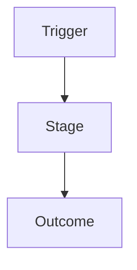
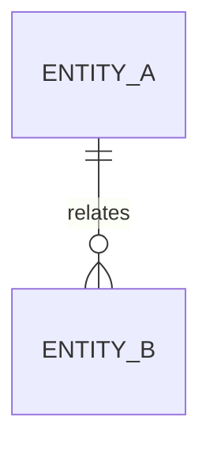
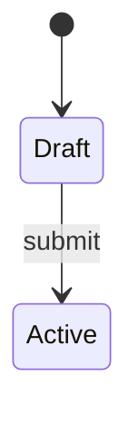
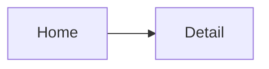

# Analyst completeness pack

**Cite ideas/practices only — do not paste copyrighted book or standard text.** Apply qualities and techniques; write original feature-specific text.

## Completeness checklist (before scopes ready)

Scale: **Done** / **N/A (reason)** / **Open (Decision log id)**. Prefer Done or explicit N/A over silence.

| # | Artifact |
|---|----------|
| P | Stakeholders, goals/weights, success criteria, boundaries, primary requirements |
| M | Process / story map (stages × actors × scenarios) + Mermaid; system/timer setup reqs |
| E | Named-entity pass (roles, objects, processes, adjacent systems, UI, reports) + questions marked |
| D | Conceptual domain model + multiplicities / odd-cardinality rules (not physical DB schema) |
| S | State diagrams where status exists (exclusive states, transitions, side effects, notifications) |
| O | CRUD + LSHAX-style matrix per object (rights, conditions, side effects, undo, audit) |
| C | Context analysis (who/why/when/where/with whom/how many/how/which + reverse/repeat) |
| X | Crystal: UC ↔ screens ↔ data ↔ reports ↔ goals; split overloaded scenarios |
| UI | Screens + navigation (primary action, defaults, validation, empty/overflow/offline, wayfinding/undo) |
| L | Lifecycle & modes (seed/test data, parallel run, cutover, upgrade, decommission) as relevant |
| Ops | Reports, monitoring, admin/ops, dirty bulk import as relevant |
| G | Glossary complete for all abbr./domain terms |
| V | Version history + change summary current |

## Techniques (practice names)

Preliminary framing; user story mapping / process stage grid; named-entity pass; conceptual ER/domain model; state diagrams; CRUD+LSHAX operations matrix; context analysis; requirements crystal; screen & navigation inventory; lifecycle & modes; ops completeness; INVEST stories; GWT acceptance (house default); EARS-style FR phrasing; decision log; change control / versioning; single source of truth.

## Requirements template

Copy into `docs/features/<feature-id>/requirements.md`. Fill every section that applies; for true N/A write **N/A — &lt;reason&gt;**. **Only the System Analyst edits this file.**

```markdown
# Requirements: <feature name>

- **Feature id:** <feature-id>
- **Version:** 1
- **Status:** draft | in-review | scopes-ready | frozen-for-dev | revised
- **Based on brief:** docs/features/<feature-id>/brief.md
- **Last updated:** YYYY-MM-DD
- **Change summary:** Initial draft.

## 1. Preliminary framing
### 1.1 Stakeholders
| Stakeholder | Interest | Decision rights |
|-------------|----------|-----------------|
| … | … | … |

### 1.2 Goals & weights
| Goal id | Goal | Weight / priority | In system? |
|---------|------|-------------------|------------|
| G-1 | … | high \| med \| low | yes \| no |

### 1.3 Success criteria
- …

### 1.4 System boundaries
- **In system:** …
- **Out of system:** …
- **Adjacent systems:** …

### 1.5 Primary requirements
- PR-1: …

## 2. Actors & systems
| Actor / system | Role in this feature |
|----------------|----------------------|
| … | … |

## 3. Glossary
| Term | Definition |
|------|------------|
| … | … |

## 4. In scope
- …

## 5. Out of scope
- …

## 6. Process model / story map
### 6.1 Story map / stage grid
| Stage | Actor A | Actor B | System / timer | Scenarios |
|-------|---------|---------|----------------|-----------|
| … | … | … | … | … |

### 6.2 Process diagram(s)


### 6.3 System / timer setup requirements
- …

## 7. Named-entity inventory
| Name | Kind (role \| object \| process \| adjacent system \| UI \| report) | Notes / open question |
|------|-------------------------------------------------------------------|------------------------|
| … | … | … |

## 8. Conceptual domain data model
### 8.1 Entities & relationships


### 8.2 Multiplicity / business rules
| Rule id | Statement |
|---------|-----------|
| BR-1 | … |

## 9. States & transitions
### 9.1 State diagram


### 9.2 Transition table
| From | To | Trigger / scenario | Side effects | Notify |
|------|----|--------------------|--------------|--------|
| … | … | … | … | … |

## 10. Operations matrix (CRUD + LSHAX)
| Object | Create | Read | Update | Delete | List | Search | History | Archive | eXecute |
|--------|--------|------|--------|--------|------|--------|---------|---------|---------|
| … | … | … | … | … | … | … | … | … | … |

## 11. Context analysis
| Action / scenario | Who | Why | When | Where | With whom | How many | How | Which | Reverse? | Repeat? |
|-------------------|-----|-----|------|-------|-----------|----------|-----|-------|----------|---------|
| … | … | … | … | … | … | … | … | … | … | … |

## 12. Requirements crystal (traceability)
| UC / story | Screen(s) | Data / entities | Report(s) | Goal id | Notes |
|------------|-----------|-----------------|-----------|---------|-------|
| … | … | … | … | … | … |

## 13. User stories / use cases
### US-1 / UC-1: <title>
**As a** <actor>, **I want** <capability>, **so that** <benefit>.
#### Acceptance criteria
1. **Given** … **When** … **Then** …

## 14. Functional requirements
### FR-1: …
(EARS-style where helpful: The system shall… / When… / While… / If unwanted… / Where feature included…)

## 15. Screens & navigation
### 15.1 Screen inventory
| Screen id | Purpose | Primary action | Priority | Defaults | Empty / overflow / offline |
|-----------|---------|----------------|----------|----------|----------------------------|
| SCR-1 | … | … | … | … | … |

### 15.2 Validation & errors
- …

### 15.3 Navigation map


### 15.4 Wayfinding & undo
- …

## 16. Shared contracts (cross-scope)
### 16.1 API / operations
| Operation | Method / channel | Request | Response | Errors |
|-----------|------------------|---------|----------|--------|
| … | … | … | … | … |

### 16.2 Data shapes / fields
| Field | Type | Required | Notes |
|-------|------|----------|-------|
| … | … | … | … |

### 16.3 Events / shared state / auth boundaries
- …

### 16.4 Error & empty states
- …

## 17. Frontend-specific
…

## 18. Backend-specific
…

## 19. Lifecycle & modes
| Mode / concern | Requirements |
|----------------|--------------|
| Seed data | … |
| Test data | … |
| Parallel run | … |
| Zero-state cutover | … |
| Upgrades / migrations | … |
| Decommission | … |

## 20. Reports, monitoring, admin / ops, import
…

## 21. Non-functional requirements
### Performance / Security & privacy / Accessibility / Reliability
…

## 22. Acceptance criteria (feature-level)
1. **Given** … **When** … **Then** …
Non-flow (optional):
- [ ] …

## 23. Decision log
| ID | Question | Status | Decision / owner | Date |
|----|----------|--------|------------------|------|
| D-1 | … | open \| decided \| deferred | … | … |

## 24. Completeness stamp
| Artifact | Status |
|----------|--------|
| Preliminary (P) | |
| Process / story map (M) | |
| Named entities (E) | |
| Domain model (D) | |
| States (S) | |
| Ops matrix (O) | |
| Context analysis (C) | |
| Crystal (X) | |
| Screens (UI) | |
| Lifecycle (L) | |
| Ops/reports/import (Ops) | |
| Glossary (G) | |

## 25. Version history
| Version | Date | Summary | Re-review scopes |
|---------|------|---------|------------------|
| 1 | YYYY-MM-DD | Initial draft | frontend, backend, qa |
```

## Finding resolution (analyst-side)

1. Confirm path + cited Requirements version; if superseded, answer against current first.
2. Classify: clarification | spec gap | **completeness gap** | contract/cross-scope | out-of-scope | **true external/reg change** | product intent unknown → human.
3. Decide; edit `requirements.md` when truth changes; bump Version; fill Analyst resolution (skill `analyst-request`); list re-review scopes; revoke readiness as needed.

### Completeness-gap hints

| Reviewer signal | Likely missing |
|-----------------|----------------|
| Who approves / who else affected? | Stakeholders / preliminary |
| What happens in this stage for role X? | Process / story map |
| Timer/job — how set up? | System/timer setup |
| What is this term / object? | Glossary; named entities |
| Odd cardinalities | Domain model; business rules |
| Statuses / notifications | State diagram + transitions |
| Search / archive / undo / audit? | CRUD + LSHAX matrix |
| When/where/with whom / how many? | Context analysis |
| Screen vs story / report / goal | Crystal; split overloaded UC |
| Primary button? Empty? Offline? | Screens & navigation |
| Seed/cutover/upgrade? | Lifecycle |
| Ops report / bulk import? | Ops/reports/import |

### Version bump rules

Bump for: clarification removing ambiguity; completeness supplement; new/changed FR/story/AC; any shared contract; scope change; named external change. Prefer bump for editorial meaning risk. No bump only when answering “already in §X” with no edit (`answered`).

### Who must re-review

Shared contract / domain model / states / ops affecting both sides → **frontend + backend + qa**. FE-only UI → frontend (+ qa if AC changed). BE-only persistence/job → backend (+ qa if AC changed). When unsure, include neighbors.

### Anti-patterns

Editing without Version bump; resolving only in chat; letting FE/BE “agree in a PR”; closing Blocking=yes without clear/escalate; silent rewrite of settled contracts; marking ready with blank Completeness stamp rows; automating an undefined process.
